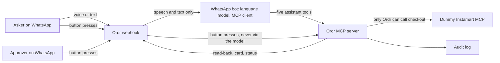
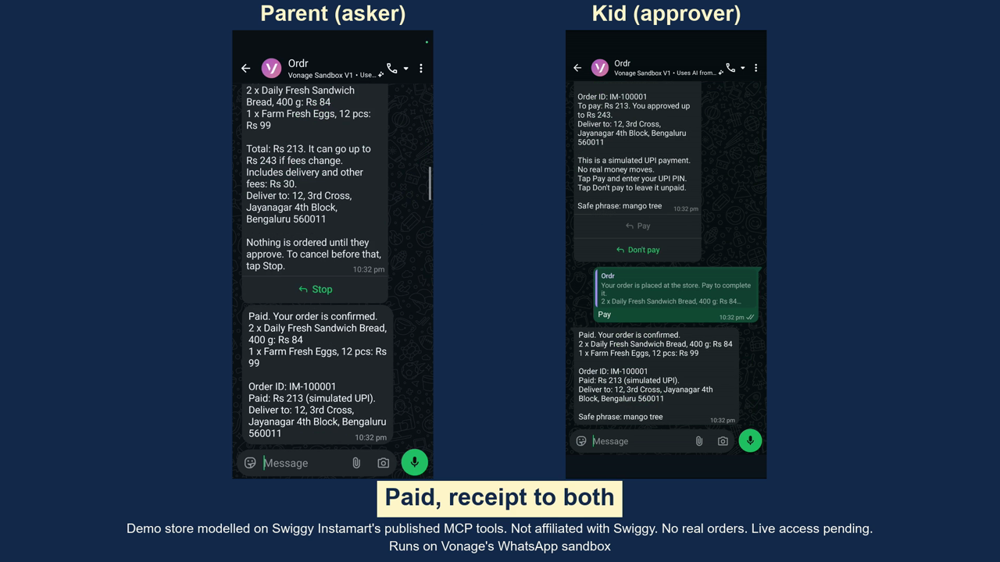
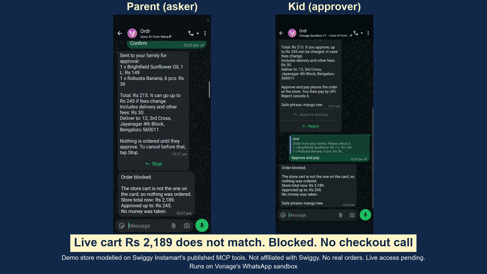

<p align="center">
  
</p>

<p align="center">
  <b>Grocery ordering for anyone who cannot order alone.</b><br>
  One person asks. Another approves and pays. The AI can shop, but it can't buy.
</p>

<p align="center">
  <a href="https://github.com/Sky00raider/Ordr/actions/workflows/test.yml"></a>
  
  
  
</p>

<p align="center">
  <a href="#try-it">Try it</a> &nbsp;|&nbsp;
  <a href="#the-problem">Problem</a> &nbsp;|&nbsp;
  <a href="#the-idea">Idea</a> &nbsp;|&nbsp;
  <a href="#see-it-work">See it work</a> &nbsp;|&nbsp;
  <a href="#why-mcp">Why MCP</a> &nbsp;|&nbsp;
  <a href="#what-is-built">What is built</a> &nbsp;|&nbsp;
  <a href="#limits">Limits</a>
</p>

Built by **DataBaes** for wHACKiest 2026, Track 1: Make MCP Matter.

> **Status:** working prototype. The demo store, the approval gate, the button presses, the checks, the simulated payment, the messages and the chat bot for typed orders are built, with tests. Kannada voice and Open in store come next.

## Try it
No WhatsApp, no API key and no accounts needed. Python 3.11 or newer.

```
git clone https://github.com/Sky00raider/Ordr.git
cd Ordr
python -m venv .venv
.venv\Scripts\activate          # macOS and Linux: source .venv/bin/activate
pip install -e ".[dev]"
python -m ordr.demo
```

It starts the demo store and the gate on your machine and runs six scenes over real MCP calls: the five tools the AI gets, a normal order, a cart changed after the asker confirms (refused, zero `checkout` calls), a price jump (refused), Stop, and the log. The assistant's item choices and the taps are scripted in this demo, and no AI model runs. Add `--pause` to step through it, or `--lang kn` for Kannada messages.

Run the tests with `pytest` (about 3 minutes).

## The problem
If you can't use a shopping app, someone else has to order for you, item by item. They take the call or the list, ask back, search each item, fill the cart and pay.

- **Elders** who find apps confusing. 66% of urban elders find technology confusing (HelpAge India 2025, 10 cities).
- **Kids** with no store account and no UPI.
- **Cooks and house help** who know what is needed but do not pay.

The person who wants it is not the person who can buy it. Ordr calls them the **asker** and the **approver**.

Letting an AI fill someone else's cart has to be safe. In Swiggy Instamart's published MCP, `checkout` takes an address and a payment method, but no items. It buys whatever is in the server-side cart at that moment, and no cancel tool is listed. What was agreed to and what gets bought can drift apart. Ordr closes that gap.

## The idea
1. The asker sends a WhatsApp voice note in Kannada or English (typed for now).
2. The bot matches it to exact store items, asks if anything is unclear, and fills the cart in the approver's store account.
3. The asker gets the order read back and taps **Confirm**.
4. The approver gets a card and taps **Approve and pay**.
5. Ordr re-reads the live cart. If it is not exactly what was approved, nothing is ordered.
6. The approver pays with their own UPI PIN (simulated in the demo).

In the code, the asker is the `parent` role and the approver is the `kid` role, from the elder example we built first. If the asker is under 18, a parent sets it up, consents and approves.



## See it work
Recorded on two phones over Vonage's WhatsApp sandbox. The order was spoken with the phone's voice typing.

| A normal order | The cart changed after Confirm |
|---|---|
|  |  |
| Confirm, approve, pay with simulated UPI. Receipt to both phones. | The live cart is Rs 2,189, approved up to Rs 245. Blocked, and nothing is ordered. |

## Why MCP
Stores already publish MCP servers, so an AI can search products and fill a cart. Our MCP server sits in between and gives the AI five tools. None of them is `checkout`.

| Tool the AI gets | What it does |
|---|---|
| `search_products` | Finds items in the store |
| `prepare_order` | Builds the cart. Ordr sends the read-back |
| `get_order_status` | Says where an order is |
| `abort_order` | Stops this household's order |
| `get_audit_log` | Shows what happened and when |

## What is built
| Part | State |
|---|---|
| Demo store, 10 MCP tools | Built |
| Gate: five assistant tools, caps, duplicate warning, item IDs only from a recent search | Built |
| Confirm, Approve, Stop, Reject, Replace, Pay, Don't pay | Built |
| Final checks, one `checkout` call per order, order read-back | Built |
| Simulated UPI, receipts, review after an unclear result | Built |
| Messages in English and Kannada | Built. Kannada wording not yet checked by a speaker |
| Chat bot for typed orders, AI item matching | Built, with tests. Item matching accuracy not measured |
| WhatsApp through Vonage's sandbox | Built. One full order and one blocked order run live on two phones |
| WhatsApp through Meta's API, Telegram | Built, with tests. Not run live end to end |
| Kannada voice notes, household defaults, Open in store | Next |

## How it stays safe
- The AI gets five tools and no `checkout`.
- Confirmations are button presses handled by code. They never pass through the AI.
- Approval is bound to the exact items, quantities and address, with a maximum total.
- Every check runs again at approval. Any failure means zero order calls.
- The order is read back before any payment message is sent.
- The audit log is tamper-evident.

## Limits
- It governs only purchases made through Ordr.
- It does not stop phone-call scams.
- Groceries and daily essentials only. No prescription medicines.

## About the demo store
Demo store modelled on Swiggy Instamart's published MCP tools. Not affiliated with Swiggy. No real orders. Live access pending.

## Docs
- [Product spec](docs/Ordr-PRD-v1.4.md)
- [Technical design](docs/TRD.md)
- [Setup and contributing](CONTRIBUTING.md)

## Credits
The approval pattern is known. We were inspired by Cite-Before-Act, airlock, VoiceGate and AP2 Cart Mandates.
