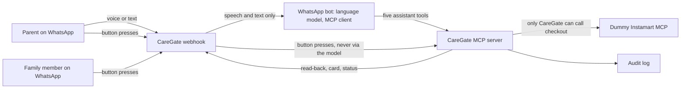

# CareGate (working name)

**An MCP approval gate between an AI assistant and a grocery store. The AI can shop, but it can't buy.**

Built for wHACKiest 2026, Track 1: Make MCP Matter.

> **Status:** design done, prototype being built. The repo has the MCP server skeletons, shared contracts and contract tests. The tools are stubs for now.

## The problem
In Swiggy Instamart's published MCP, `checkout` takes an address and a payment method, but no items. It buys whatever is in the server-side cart at that moment, and no cancel tool is listed. What the user agreed to and what gets bought can drift apart.

In India, 36% of older parents have at least one migrant child (Sarkar 2023, LASI). Ordering groceries online for them means someone else finds every item, checks it and pays.

## The idea
1. A parent sends a WhatsApp voice note in Kannada or English.
2. The bot matches it to exact store items and asks if anything is unclear.
3. The parent hears the order read back and taps **Confirm**.
4. Their chosen family member gets a card and taps **Approve and pay**.
5. CareGate re-reads the live cart. If it is not exactly what was approved, nothing is ordered.
6. The family member pays with their own UPI PIN (simulated in the demo).

## How it stays safe (by design)
- The AI gets five tools and no `checkout`.
- Confirmations are button presses handled by code. They never pass through the AI.
- Approval is bound to the exact items, quantities and address, with a maximum total.
- Every check runs again at approval. Any failure means zero order calls.
- The order is read back before any payment message is sent.
- The audit log is tamper-evident.

## Limits
- It governs only purchases made through CareGate.
- It does not stop phone-call scams.
- Groceries and daily essentials only. No prescription medicines.

## About the demo store
Demo store modelled on Swiggy Instamart's published MCP tools. Not affiliated with Swiggy. No real orders. Live access pending.

## Docs
- [Product spec](docs/CareGate-PRD-v1.4.md)
- [Setup and contributing](CONTRIBUTING.md)

## Credits
The approval pattern is known. We were inspired by Cite-Before-Act, airlock, VoiceGate and AP2 Cart Mandates.
