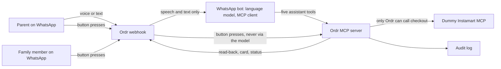

# Ordr

**An MCP approval gate between an AI assistant and a grocery store. The AI can shop, but it can't buy.**

Built for wHACKiest 2026, Track 1: Make MCP Matter.

> **Status:** working prototype. The demo store, the approval gate, the button presses, the checks, the simulated payment and the messages are built and tested. The chat bot is being built. Kannada voice and Open in store come next.

## Try it
No WhatsApp, no API key and no accounts needed. Python 3.11 or newer.

```
git clone https://github.com/Sky00raider/Ordr.git
cd Ordr
python -m venv .venv
.venv\Scripts\activate          # macOS and Linux: source .venv/bin/activate
pip install -e ".[dev]"
python -m ordr.demo
```

It starts the demo store and the gate on your machine and runs six scenes over real MCP calls: the five tools the AI gets, a normal order, a cart changed after the parent confirms (refused, zero `checkout` calls), a price jump (refused), Stop, and the log. The assistant's item choices and the taps are scripted in this demo, and no AI model runs. Add `--pause` to step through it, or `--lang kn` for Kannada messages.

Run the tests with `pytest` (about 3 minutes).

## The problem
In Swiggy Instamart's published MCP, `checkout` takes an address and a payment method, but no items. It buys whatever is in the server-side cart at that moment, and no cancel tool is listed. What the user agreed to and what gets bought can drift apart.

In India, 36% of older parents have at least one migrant child (Sarkar 2023, LASI). Ordering groceries online for them means someone else finds every item, checks it and pays.

## The idea
1. A parent sends a WhatsApp voice note in Kannada or English.
2. The bot matches it to exact store items and asks if anything is unclear.
3. The parent hears the order read back and taps **Confirm**.
4. Their chosen family member gets a card and taps **Approve and pay**.
5. Ordr re-reads the live cart. If it is not exactly what was approved, nothing is ordered.
6. The family member pays with their own UPI PIN (simulated in the demo).



## What is built
| Part | State |
|---|---|
| Demo store, 10 MCP tools | Built |
| Gate: five assistant tools, caps, duplicate warning, item IDs only from a recent search | Built |
| Confirm, Approve, Stop, Reject, Replace, Pay, Don't pay | Built |
| Final checks, one `checkout` call per order, order read-back | Built |
| Simulated UPI, receipts, review after an unclear result | Built |
| Messages in English and Kannada | Built. Kannada wording not yet checked by a speaker |
| Chat bot (WhatsApp, with Telegram as backup) and AI item matching | Being built |
| WhatsApp through Vonage's sandbox, as a second WhatsApp provider | Built and tested with mocked HTTP. Not run live with the full flow |
| Kannada voice notes, household defaults, Open in store | Next |

## How it stays safe
- The AI gets five tools and no `checkout`.
- Confirmations are button presses handled by code. They never pass through the AI.
- Approval is bound to the exact items, quantities and address, with a maximum total.
- Every check runs again at approval. Any failure means zero order calls.
- The order is read back before any payment message is sent.
- The audit log is tamper-evident.

## Limits
- It governs only purchases made through Ordr.
- It does not stop phone-call scams.
- Groceries and daily essentials only. No prescription medicines.

## About the demo store
Demo store modelled on Swiggy Instamart's published MCP tools. Not affiliated with Swiggy. No real orders. Live access pending.

## Docs
- [Product spec](docs/Ordr-PRD-v1.4.md)
- [Technical design](docs/TRD.md)
- [Setup and contributing](CONTRIBUTING.md)

## Credits
The approval pattern is known. We were inspired by Cite-Before-Act, airlock, VoiceGate and AP2 Cart Mandates.
