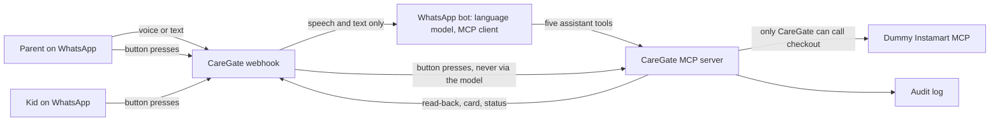

# CareGate PRD v1.4.2

**Working name:** CareGate (alternatives: Anumati, Nambike, Nod)
**Track:** wHACKiest 2026, Track 1 (Make MCP Matter)
**Date:** 24 Nov 2026
**Replaces:** v1.3. Changes are listed in sections 13 to 15.

## 1. What it is

An MCP approval layer between an AI assistant and a grocery store. A parent sends a WhatsApp voice note in their own language. A family member the parent chose (the "kid" in this document) sees the exact order on WhatsApp, approves it with one tap and pays by UPI. CareGate places an order only if it is the order that was approved.

> "Voice ordering already exists. The missing piece is the second-person gate."

**Why this has to exist:** in Swiggy Instamart's published MCP, `checkout` takes an address and a payment method, but no items. It buys whatever is in the server-side cart at that moment, and orders cannot be cancelled through the tools. So "the user said yes" and "what gets bought" can drift apart. CareGate binds the two.

**Why MCP:** the gate sits at the tool boundary. **The WhatsApp bot is the MCP client.** It calls CareGate's assistant tools: `search_products`, `prepare_order`, `get_order_status`, `abort_order`, `get_audit_log`. CareGate is in turn an MCP client of the store. Another MCP assistant could use the same five tools later and get the same rules, approvals and log. This build has one client, the WhatsApp bot. Confirmations would still happen on WhatsApp.

**What it does not do**
- It governs only purchases made through CareGate. An assistant connected directly to a store bypasses it.
- It does not place the order on the "Open in store" path. There the kid checks out in the store app.
- It does not stop phone-call scams such as "digital arrest".
- No prescription medicines. Groceries and daily essentials only.
- No covert monitoring. The parent opts in, picks the kid who approves, sees the same log, and can revoke at any time.

## 2. Evidence

| Claim | Source | Use as |
|---|---|---|
| 36% of older parents have at least one migrant child; 35% are empty nesters | Sarkar 2023, LASI (PMC10523011) | Core problem |
| 66% of urban elders find technology confusing; 51% fear making errors; 41% have smartphones (10 cities incl. Bengaluru) | HelpAge India 2025 | Core problem, and an honest limit on reach |
| 1,03,488 senior cyber-fraud complaints in 2025, about Rs 4,005 crore lost | Home ministry data via ET / the420 | Background only |
| RBI paper discusses "authorised push payment" fraud, where the victim makes the payment, and floats a "trusted person" as extra authenticator for people aged 70+ and persons with disabilities, above Rs 50,000 | RBI discussion paper, Apr 2026 (rbi.org.in, publication 23810) | "The regulator is considering the second-person principle." **A proposal, not a rule. Merchant payments can be exempted.** |
| 63-year-old in Rajkot lost Rs 1.91 lakh to fake quick-commerce customer care | India Today | Background only |

Not for slides: "45% struggle to spot scams" (Storyboard18, secondary, original survey not checked, and we do not stop scams), the Blinkit seniors study (snippet only), dementia and disability figures (the 8.8M estimate uses 2016 population and raises consent questions).

## 3. Who it is for

- **Parent:** lives apart from their children, uses only WhatsApp, does not use shopping apps, and already relies on a child for every order. Wants to order in their own words.
- **Kid (approver):** today takes the list, searches every item, adds to cart, pays. With CareGate: reads one card, taps once, enters a UPI PIN. Chosen by the parent. Can be any trusted person.

## 4. Demo store and vendors

**Demo:** a dummy Swiggy Instamart. A local MCP server that uses the tool names and order flow from Swiggy's public documentation, with made-up products and no real orders.

**Account:** the store account is the kid's, because the kid pays. The parent's address is saved on that account and fixed at setup. Every CareGate order goes to that address.

Label on the screen, slide and video:
> "Demo store modelled on Swiggy Instamart's published MCP tools. Not affiliated with Swiggy. No real orders. Live access pending."

Do not use Swiggy's logo, colours, or the "Powered by Instamart" badge. The badge is for real integrations.

| Vendor | Where we stand |
|---|---|
| Swiggy Instamart | First choice. Invite-based; developers get staging (seeded data) during review, production after 48 h green staging. Say "applied" only once we have. Its README still says third-party apps are not permitted, while the Builders docs invite applications; ask builders@swiggy.in. |
| Zepto | Hoped for. Official MCP places real orders and has no sandbox. Localhost login is whitelisted; hosted apps are not. |
| ONDC sellers | Hoped for. Open network that allows chatbots and voice assistants as buyer apps. Needs whitelisting and certification of unknown duration. An `ONDC-Official/ondc-mcp` repo exists but is a year old and depends on an external pre-production backend. |

Roadmap, not in this build: Razorpay, live vendor access, checks across more than one store.

## 5. How it works

WhatsApp is the only channel for both people. There are no web pages for either.



1. Parent sends a voice note (or text) to the CareGate WhatsApp number.
2. Speech is transcribed. The bot, as MCP client, turns it into items using AI item matching (section 6A).
3. If anything is unclear, the bot asks the parent one short question, by voice and text.
4. CareGate builds the store cart, reads it back from the store, and sends the parent a read-back (voice and text): items, quantities, total, address.
5. Parent taps a WhatsApp **Confirm** button.
6. Kid gets a WhatsApp card: items, total, "up to" amount, address, safe-phrase, duplicate warning if any. Buttons: **Approve and pay / Open in store / Reject**. The parent gets "sent to your kid" with a **Stop** button, which works until the kid approves.
7. Kid taps Approve and pay. CareGate signs the approval, re-reads the live cart and runs every check in section 6 straight away.
8. All checks pass: CareGate calls `checkout`. The order is `PENDING_PAYMENT`.
9. CareGate reads the order back. Only if it matches does the kid get the UPI payment message (simulated in the demo), with **Pay / Don't pay**. The kid enters a UPI PIN.
10. Payment confirmed, status read back, receipt stored, log updated. Both people get the receipt.

Steps 7 to 9 take seconds, so the kid is interrupted once. **The UPI PIN is the last undo:** no PIN, no money.

Checking again at step 9 matters: a cart could still change in the instant between steps 7 and 8, and at step 9 no money has moved. Payment is not automatic. Cash on delivery skips the step 9 protection, so it is off.

### Before filling the kid's cart (step 4)

The cart belongs to the kid's account, and `update_cart` replaces the whole cart. So this rule applies on both paths:

- Cart empty, or holding only what CareGate put there: fill it.
- Cart has anything else: do not touch it. Tell the parent "waiting for your kid" and ask the kid "Your cart has 4 items. Replace it?" with buttons **Replace / Not now**.
- Only one open CareGate order per store account at a time. Before the parent taps Confirm, a new `prepare_order` replaces the draft and the old buttons stop working. After Confirm, `prepare_order` is refused until the order ends; the parent can tap Stop first.

### "Open in store" path

Fallback for a kid who wants to edit the order.

1. Kid taps Open in store.
2. CareGate reads the cart. If it already matches the list the parent confirmed, the kid gets "cart ready" at once. Go to step 5.
3. If it does not match, CareGate warns that the confirmed list will replace the whole existing cart. Buttons: **Fill cart / Cancel**.
4. CareGate fills the cart, reads it back from the store and compares it. If it matches, "cart ready". If not, the kid is told what differs and it is not called ready.
5. The kid edits and checks out in the store app.

On this path the caps, price ceiling and checkout checks do not apply, because CareGate does not place the order. The log records `HANDED_OFF`, not a purchase.

## 6. Security design

### Rule 1: the assistant never supplies a fact the gate checks

CareGate reads the cart and total from the store. It takes consent only from button presses by the registered parent and kid.

### Rule 2: button presses never pass through the language model

Parent Confirm and Stop, and kid Approve, Reject, Pay and Don't pay, are handled by CareGate's webhook directly. So are Replace, Fill cart and Cancel. The model cannot produce or interpret a confirmation. A voice note or text saying "yes, confirm" does not count; the bot asks the person to tap the button.

### Rule 3: the model does not write what people approve

The read-back, the kid's card, payment messages and status messages are built by CareGate code from the store's data. The voice read-back is made from that same text. The model writes only clarifying questions to the parent. It cannot send buttons, and cannot message the kid.

**Tools the assistant can call.** The assistant is the WhatsApp bot, acting as MCP client.

| Tool | Input | Does |
|---|---|---|
| `search_products` | `query` | Read-only search. Marks the household's usual item if it is in the results |
| `prepare_order` | `items: [{sku_id, spin_id, qty, heard_as}]` | Builds cart, returns `mandate_id`. CareGate sends the read-back |
| `get_order_status` | `mandate_id` | Read-only |
| `abort_order` | `mandate_id` | Stops an order. Aborting is always safe, so the assistant may do it |
| `get_audit_log` | `limit` | Read-only, for the parent's household |

`parent_id` and `address_id` are not inputs. The household comes from the sender's WhatsApp number, and the address is fixed at setup. The model sees neither the store token nor the safe-phrase.

**Not available to the assistant**

| Action | Who | Where |
|---|---|---|
| Confirm read-back | Parent | WhatsApp button, handled by the webhook |
| Approve, Open in store, Reject | Kid | WhatsApp button, handled by the webhook |
| Stop, Don't pay | Parent, kid | WhatsApp button, handled by the webhook |
| Replace or fill the kid's cart | Kid | WhatsApp button, handled by the webhook |
| Commit, `checkout`, `confirm_order` | CareGate only | Server, after approval and checks |

### Identity

- Parent and kid are identified by their registered WhatsApp numbers.
- A button press counts only if it comes from the registered number for that role and refers to the current `mandate_id`. Presses on older messages are ignored.
- The webhook checks the provider's signature on every call. Without this, anyone could post a fake button press.
- Limit: whoever holds the unlocked phone, or takes over the number, can press the button. For the kid, the UPI PIN is still needed before money moves.

### Ownership and roles

Every tool call and button press is checked on the server. A `mandate_id` from another household gets "not found". A role or household is never taken from a tool argument.

| Who | Can do |
|---|---|
| Parent | Talk to the bot (the five tools, own household only), Confirm, Stop |
| Kid | Approve, Open in store, Reject, Pay, Don't pay, Replace or fill cart. Buttons only, for their own household |
| Unregistered number | Nothing. A fixed reply at most |

The kid's chat does not reach the model. Typing "log" returns the audit log; anything else gets a fixed reply.

**Repeated deliveries:** WhatsApp providers can deliver the same message twice. CareGate saves each message ID and ignores repeats, so one voice note cannot create two orders and one tap cannot count twice.

### What is bound

```
cart_hash = SHA-256(canonical JSON of
    store, sorted [(sku_id, spin_id, qty)], address_id, address_text, currency)

approval  = HMAC-SHA256(server_key,
    mandate_id, cart_hash, max_total_paise, approver_id, nonce, expires_at)
```

The approval is bound when the kid taps Approve and pay. The UPI PIN is a second check at payment.

**Canonical JSON:** sorted keys, no spaces, UTF-8 with NFC normalisation, whole numbers only for quantities, repeated items merged, items sorted by `sku_id` then `spin_id`. Money anywhere in the system is whole paise. The same cart must always give the same hash.

**Prices and fees are not in the hash.** The hash covers what and where. The ceiling covers how much. With fees in the hash, the Rs 18 rain fee would be refused. The quoted line prices and fees are saved with the approval and written to the log, so a refusal can show what changed.

Address text is included because the text behind an `address_id` can be edited. Device-held approver keys (passkeys) are roadmap; today the HMAC proves the gate recorded the approval, not which device made it.

### Price ceiling

`max_total = quoted total + Rs 30`, shown on the card as "up to".

Example used everywhere in the demo: quoted Rs 345, ceiling **Rs 375**.

| Change | New total | Result |
|---|---|---|
| Rs 18 rain fee | Rs 363 | Passes |
| Rs 250 jump | Rs 595 | Refused; new approval needed |

v1.2's 5% buffer gave Rs 362.25, so its own Rs 18 example would have failed.

### Caps

Kept, because approval alone fails if the kid taps without reading or is tricked. Two only, checked in code:
- **Per order:** Rs 1,500
- **Per month:** Rs 6,000, counting placed and in-progress orders

Both compare against `max_total`. Going over is refused, not sent for approval. Caps are agreed at setup and fixed for the demo. Later, only the parent can change them, through WhatsApp buttons handled by the webhook, never through the assistant.

### Duplicate check

Same items and quantities to the same address within 120 minutes, counting handed-off carts as possible orders. The parent is told "you ordered this 2 minutes ago, order again?" and the button reads **Order again**. The kid's card shows the warning and the first button reads **Approve duplicate**. It warns rather than blocks, because ordering twice can be genuine. Single store for now.

Swiggy's `checkout` can also reject a probable duplicate and ask for `confirmDuplicate`. CareGate never sets this on its own. If it happens, the order is refused and the kid is asked.

### Final checks, in order, right after approval

1. Mandate is `APPROVED`, not used, approval signature valid, approved before expiry
2. Live cart hash equals approved hash
3. Live total at or below `max_total`
4. Items in stock, address serviceable
5. Caps not exceeded
6. Move `APPROVED` to `COMMITTING` and mark used, in one atomic database update. If that update changes no row, stop
7. Call `checkout` with UPI set explicitly

Any failure in steps 1 to 6 refuses the order, logs the reason, and makes **zero order calls**. Reads still happen.

If `checkout` errors or times out, do not retry: check `get_orders` first. Swiggy documents `checkout` as unsafe to repeat.

### No hold before payment

v1.4.1 had a 60 s hold between approval and checkout. It is removed. It made the kid wait and interrupted them twice, although no money moves before the UPI PIN. Undo is now:

| When | How to undo | Result |
|---|---|---|
| Before the kid approves | Parent taps Stop, or kid taps Reject | `ABORTED` or `REJECTED`. No order call |
| During the checks (seconds) | Parent taps Stop | `ABORTED` if it lands before `COMMITTING` |
| After `COMMITTING`, before the payment message | Parent taps Stop | Too late to prevent the order. No payment message. `NEEDS_REVIEW` |
| After the payment message, before payment | Kid taps Don't pay or ignores it. Parent taps Stop and the kid is told "do not pay" | `UNPAID` if the store confirms the order failed or was cancelled, otherwise `NEEDS_REVIEW` |
| After payment | Not possible through CareGate | Customer care |

CareGate cannot block a UPI payment already started. Every state change is one atomic update, so Stop and Approve cannot both win.

**Cost of this choice:** a kid who approves and does not pay leaves an unpaid order at the store. What Swiggy does with it is not known yet (section 12).

### Crashes and review

**Server restart.** `APPROVED` becomes `EXPIRED` and the kid is told. `COMMITTING` becomes `NEEDS_REVIEW`, never a retry.

**`NEEDS_REVIEW`.** The store may have an unpaid order that no tool can cancel. CareGate sends no payment message, does not retry, tells both people, and gives the kid the order ID if known, with advice to check the store app or customer care. New orders on that account are blocked until the kid taps **I have checked it**.

### States

`PREPARED > PARENT_CONFIRMED > APPROVED > COMMITTING > PLACED_PENDING_PAYMENT > PAID`

Open in store: `PARENT_CONFIRMED > HANDED_OFF`, with `HANDOFF_WARNED` in between only if the cart changed

Ends: `REJECTED`, `EXPIRED`, `ABORTED`, `UNPAID`, `HANDED_OFF`, `BLOCKED(reason)`, `NEEDS_REVIEW` (store result unknown, order does not match on read-back, or a late Stop).

### Policy file

```json
{
  "auto_approve": false,
  "per_order_cap_paise": 150000,
  "monthly_cap_paise": 600000,
  "surge_ceiling_paise": 3000,
  "duplicate_window_minutes": 120,
  "mandate_ttl_minutes": 60,
  "search_result_ttl_minutes": 15,
  "backup_approver_after_minutes": null,
  "allowed_payment": ["UPI"]
}
```

`backup_approver_after_minutes` is off in this build. `mandate_ttl_minutes` is 60 so a kid in a meeting can still approve; live price, stock and cart checks run at approval, so a late tap is still safe.

### Safe-phrase: kept

Decision: keep it on the kid's card and payment message.
- A UPI PIN does not protect against a fake payment link. Entering the PIN there pays the scammer.
- People do not always check the sender, and the demo may run on a shared or test number that is not a verified CareGate number.
- It costs one line.

Its limit: a forwarded card or screenshot leaks it. So it is one sign among three, with the sender and the payee name. It never appears in messages to or from the model.

### Threats

| Threat | Answer |
|---|---|
| Cart changed after the parent confirmed (another AI assistant, device or person on the same store account) | Live cart re-read and re-hashed at approval; mismatch refused |
| Assistant claims the parent agreed | Consent only from a button press by the registered number, handled outside the model |
| Assistant reports a false low total or false read-back | Total and message text come from the store through CareGate code |
| One household acts on another's order | Ownership and role checked on every tool call and press |
| Same webhook delivered twice, or a double tap | Message IDs saved, repeats ignored; state changes are atomic |
| Stop and Approve tapped together | Atomic state changes, only one wins; a late Stop means no payment message |
| Approval reused, or an old button tapped | Single use, nonce, 60-minute expiry, current `mandate_id` only |
| Fake message pretending to be CareGate | Messages only from the verified CareGate business number, plus the UPI PIN. The kid also checks the safe-phrase and payee name before entering the PIN. Not fully true in the demo: a sandbox number is not verified |
| Forged webhook call | Provider signature checked on every call |
| Misheard or wrongly matched item | Clarifying question, read-back, parent Confirm, kid sees items on the card |
| Cart changes between check and checkout | Order re-read before payment; no payment if different |
| Kid's own cart wiped | Cart read first; replaced only after the kid taps Replace |
| Store token leak | Encrypted at rest, never sent to the model |
| Log edited later | Each row includes the previous row's hash, and `verify_log` checks the chain (tamper-evident, not immutable). Limit: deleting the newest rows, or rebuilding the whole chain, is not caught unless the latest hash is also kept elsewhere |

## 6A. AI item matching

Turns what the parent says into exact store products.

**Understands**
- Local words and brand names: "haalu", "Nandini".
- Loose quantities: "half kg", "two small packets".
- Mixed languages in one message: Kannada and English in the demo.

**Where products come from**
- Every `sku_id` and `spin_id` must come from a store search for this household in the last 15 minutes. CareGate keeps the results itself; `prepare_order` refuses any other.
- The model never invents a product, price or quantity unit. Pack sizes come from the store's own description. Prices and totals come only from the store.

**Household defaults**
- CareGate stores each household's usual choices from past confirmed orders. Example: "haalu" means their usual milk, with brand and pack size.
- A default is used only after the parent has confirmed it at least once, by tapping Confirm on an order that contained it.
- A default must still appear in the current search and be in stock. It is always shown in the read-back.
- The parent can clear the defaults with a button.

**When to ask**

| Situation | Action |
|---|---|
| Confirmed default, in stock | Use it |
| Exactly one result fits the spoken item, brand and size | Use it |
| More than one fits, or size or brand not clear | Ask one short question |
| Loose quantity does not match a pack ("half kg", store has 1 kg) | Ask |
| Not found, or out of stock | Offer the closest option and ask. Never auto-swap |
| Several items unclear | Ask about all of them in one message |

Never silently substitute a different brand or size. The model's own sense of "clear" can be wrong. The read-back, the parent's Confirm and the kid's card are there to catch that.

**What is stored:** phrase, product, pack size, usual quantity, last confirmed date. Voice recordings are deleted after transcription unless the parent agrees to keep them. See Privacy in section 10.

**How we will test it:** a small set of real voice notes from team families, collected with their consent, each with the expected items. We report the match rate on that set, how often it asked a question, and how often it was wrong without asking. No accuracy numbers until measured.

## 7. Dummy Instamart server

Tools, with names from Swiggy's docs: `get_addresses`, `search_products`, `update_cart`, `get_cart`, `clear_cart`, `get_payment_options`, `checkout`, `check_payment_status`, `confirm_order`, `get_orders`.

Behaviour to copy:
- `update_cart` replaces the whole cart
- `checkout` takes no items
- UPI orders start in `PENDING_PAYMENT`; `confirm_order` completes them
- Search returns variations with `skuId`, `spinId`, pack size, stock and maximum quantity, and may return similar products
- Rs 99 minimum order
- No cancel tool
- Unpaid UPI orders are marked failed after 5 minutes. **Our assumption**, not from the docs (section 12)

Switches for the demo: add a Rs 1,999 item to the cart (as if another AI assistant on the same store account did it), change the address, add an Rs 18 fee, add a Rs 250 fee, mark an item out of stock, start with items already in the kid's cart.

About 15 products is enough. Include at least two kinds of milk and two pack sizes, so the clarifying question is real. Check each response shape against the docs before coding; link: mcp.swiggy.com/builders/llms.txt

## 7A. Tech choices

Nothing here has been tested by us.

| Part | Options | Status |
|---|---|---|
| WhatsApp | 1. Meta Cloud API (needs business setup). 2. Twilio WhatsApp sandbox as demo fallback. 3. Telegram as last resort | To verify |
| Buttons | Meta docs: up to 3 reply buttons, 20 characters each. Twilio docs: 3 quick-reply buttons in a session without template approval. Our longest label, "Approve duplicate", is 17 | To verify on the one we pick |
| Messaging window | Buttons without a template need the person to have messaged in the last 24 hours. In the demo, both phones send "hi" first. Real use needs an approved template for the kid's card | To verify |
| Speech-to-text, Kannada and English | Sarvam, Google Cloud, Whisper. Sarvam docs list Kannada and a code-mix mode, with a 30 s limit on the simple REST call | To verify, including WhatsApp's voice-note format |
| Text-to-speech, Kannada and English | Sarvam, Google Cloud, ElevenLabs | To verify |
| UPI payment from WhatsApp | Simulated in the demo. How a real UPI link from `checkout` opens from a chat is unknown | To verify |

If we use Telegram, say so on screen. Do not call it WhatsApp.

## 8. Delivery

### By 24 Nov, 11:59 PM IST: basic demo

The video must show a prototype walkthrough and the repo must hold a proof of concept, so this comes before recording.

| Must | If time allows |
|---|---|
| WhatsApp bot for parent and kid, with buttons | Backup approver |
| Kannada and English voice in | ElevenLabs voice |
| Read-back, voice and text | More languages |
| AI item matching with household defaults and clarifying questions | |
| The full v1.3 gate: hash, ceiling, caps, single use, expiry, final checks, duplicate warning, audit log, Stop and Don't pay. No hold | `verify_log` command |
| Ownership checks, canonical JSON, atomic state changes, repeated messages ignored | Restart handling |
| "Open in store" fallback | |
| Dummy store with switches | |
| Text order input | |

**WhatsApp timebox: 90 minutes in total, first thing.** Goal: one button message and one voice note received. Try Meta's test number for 45 minutes, then Twilio for 45. If neither works, use Telegram for this demo, say so on screen, and move WhatsApp to 25 to 26 Nov or 1 to 2 Dec. Keep the channel code separate from the gate so the switch is small.

**Build order.** Each step leaves something that can be recorded:
1. Dummy store and gate, with tests
2. Buttons on WhatsApp, with text orders
3. Item matching and clarifying question
4. Voice in, then voice read-back
5. Household defaults, duplicate warning, Open in store

If a step is not finished, the video and slides say so.

Tests to have passing:
- Normal order goes through
- Changed cart refused
- Reused approval refused
- Over-cap refused
- Approval after expiry refused
- Unclear item triggers a question
- Matched item must come from search
- Button press from an unregistered number ignored
- Model output cannot confirm an order
- Kid's existing cart is not replaced without a tap
- Same cart in a different item order gives the same hash
- Double Approve counts once; same webhook twice counts once
- A `mandate_id` from another household is refused
- Stop and Approve at the same moment: only one wins
- Approve after the parent's Stop is refused
- Don't pay: no payment, order ends `UNPAID` or `NEEDS_REVIEW`
- Open in store with an unchanged cart: no second warning
- Rs 18 fee passes, Rs 250 jump refused, item out of stock refused, address change refused
- New order after Confirm, while one is open, is refused
- `checkout` timeout: `get_orders` is read, `checkout` is not called again
- Order differs on read-back: `NEEDS_REVIEW`, no payment message
- If `verify_log` is built: an edited row makes it fail

Submission checklist:
- [ ] PPT on the strict official template, no extra slides, named `TeamName_TrackNumber`, public Drive link
- [ ] YouTube video, 3 to 5 min: problem, solution, technical approach, prototype walkthrough
- [ ] Public GitHub repo, same one used until presentations. No tokens, phone numbers or family voice notes in it

### 25 to 26 Nov, before the online pitch (5 min plus 3 min Q&A)

Anything unfinished above, item matching test on family voice notes, Swiggy application with demo video, ONDC Participant Portal sign-up.

### 1 to 2 Dec, offline build

Backup approver if not done, more languages, WhatsApp templates and a proper business number. Vendor staging only if access has arrived.

### Suggested split

1. Gate: checks, hash, states, log
2. Dummy store and switches, item matching and defaults
3. WhatsApp bot, webhook, buttons, voice
4. PPT, video, family interviews and voice notes

## 9. Demo script (about 3 min)

1. **Order:** parent sends a Kannada voice note for milk and atta. Bot asks one clarifying question, reads back Rs 345, parent taps Confirm.
2. **Approve:** kid gets the card, taps Approve and pay. Checks run, order placed, simulated UPI, receipt to both.
3. **Tamper:** a new order is confirmed and the kid's card sits unread during a meeting. Another AI assistant connected to the same store account adds a Rs 1,999 item. The kid taps Approve on what the card shows. CareGate compares approved hash and live hash, refuses, zero order calls. Show the MCP calls on screen for about 10 seconds: `get_cart`, hash mismatch, no `checkout`.
4. **Stop:** parent taps Stop before the kid approves. The kid's Approve is refused. Rs 0 spent.
5. **Quick:** "Open in store" path, then the duplicate warning.

Do not say our own assistant changed the cart. It has no cart tool. Keep the full MCP message inspector for Q&A. Record a backup of the full run, and a recorded voice note in case the room is noisy.

## 10. Competition and claims

| Exists | Difference |
|---|---|
| UPI Circle | Approves a payment amount. Does not see items, quantities or address |
| Swiggy voice ordering | One person, one app, no second-person approval |
| JioMart on WhatsApp | Voice or chat to cart for one person. CareGate adds second-person approval with one tap to place the order safely, and household-aware item matching |
| food-cli (open source; voice-agent-driven, accessibility-focused, Swiggy and Zepto MCPs; learns preferences from order history) | Same user confirms their own order. CareGate adds second-person approval, with the approval bound to the cart. Household defaults there are for one user |
| Cite-Before-Act, airlock, VoiceGate, Aegis and similar | Same approval idea, built for developers or one user. We borrow the pattern and credit it |
| Notme, ClearGate, Kavach | Family approval of payments, not of grocery carts |
| Google AP2 v0.2 (FIDO Alliance) | We found no dual-party approval flow in the parts we read |
| GenWise | Inc42: operations "paused", most staff laid off. Reason we are a thin layer and not an elder app |

**Say:** "We found no...", "inspired by AP2 Cart Mandates", "tamper-evident", "the approval engine is a known pattern; the new part is applying it to a family and a real grocery flow."
**Do not say:** "MCP vulnerability" (say "gap": Swiggy's docs tell agents to confirm, but nothing enforces that the cart stays the same), "Trusted Person Mechanism" (the RBI text we read says "trusted person"), first, only, proves, immutable, AP2-compliant, works in any app, real orders, live Swiggy, fully automatic, any matching accuracy we have not measured, that WhatsApp or voice ordering is new.

**Privacy:** DPDP Rules (13 Nov 2025). An ordinary adult parent consents for themselves. Under Rule 11, only a legally appointed guardian can consent for a person with a disability who has one; that case is out of scope. Messages pass through WhatsApp and the chosen speech provider, and the parent is told this at opt-in. CareGate keeps household defaults, order records and the log. It does not keep voice recordings unless the parent agrees. The kid sees orders, not the parent's voice notes or chat.

## 11. Changes from v1.2

| Team decision | What changed |
|---|---|
| 1. Basic demo by 24 midnight | Build moved before the deadline, with a minimum list (section 8) |
| 2. Fix holes | Server owns cart, total and consent; order re-read before payment; hash covers address text; log wording (section 6) |
| 3. Caps if needed | Kept, two only (section 6) |
| 4. Fix numbers | Flat Rs 30 ceiling, Rs 345 to Rs 375 (section 6) |
| 5. Dummy Instamart, name hoped-for vendors | Section 4 |
| 6. Razorpay | Roadmap |
| 7. Flatmate Gate | Dropped |
| 8. Vendor access | Stated as pending; live integration removed from must-haves |
| 9. Overclaims | Section 10 |
| 10. Submission rules | Section 8 |
| 11. Extra Q&A answers | Left out |

## 12. Open

- Final name
- Ask 3 families, including whether the parent uses WhatsApp voice notes
- Cap amounts are placeholders; adjust after the families answer
- Nothing has been tested against a live vendor
- Verify WhatsApp API option and button support
- Pick and test Kannada speech-to-text
- Collect test voice notes from families, with consent
- Verify Swiggy `checkout` has no items field and no cancel tool, against mcp.swiggy.com/builders/llms.txt. Docs read 24 Nov: parameters are `addressId`, `paymentMethod`, `intentApp`, `generateUPIQR`, `confirmDuplicate`; no Instamart cancel tool is listed; users are told to call customer care. Not yet tested on a live server
- Verify that a cart filled over MCP shows up in the store app. "Open in store" depends on it. Swiggy's README says not to have the app open while MCP is in use
- Verify what happens to a Swiggy order left in `PENDING_PAYMENT`. More important now that there is no hold
- Verify how long an Instamart cart lives. If it is under 60 minutes, a late approval is refused and the parent confirms again
- Swiggy may split one cart into several store orders. Decide how to check that, or refuse such carts

## 13. Changes from v1.3

| Team decision | What changed |
|---|---|
| 1. WhatsApp only | No web pages. Buttons on WhatsApp for both people; moved from 1 to 2 Dec into the core build (sections 3, 5, 6, 8) |
| 2. Bot is the MCP client | Stated in sections 1, 5 and 6 |
| 3. Native-language voice is core | Kannada and English, in and out (sections 5, 7A, 8) |
| 4. AI item matching | New section 6A |
| 5. One tap plus UPI | Default flow; payment stays a separate step with the UPI PIN (section 5) |
| 6. Open in store | Fallback path, states and limits (sections 5, 6) |
| 7. Store account is the kid's | Section 4. Payer question closed |
| Safe-phrase | Kept, with reasons (section 6) |

Added because the decisions above needed it:

| Addition | Why |
|---|---|
| Kid's cart is never replaced without a tap, on both paths | Reading the cart back for the parent already fills the kid's cart, so the warning is needed before approval too |
| Read-back and card text written by code, not the model (rule 3) | Otherwise the model could show one cart and prepare another |
| Webhook signature check | Otherwise a button press could be forged |
| `address_id` removed from `prepare_order` | The address is fixed at setup, so the model should not choose it |
| Duplicate tick replaced by changed button labels | WhatsApp has no tick box and the card already uses three buttons |
| Caps fixed at setup | The parent page is gone |
| Swiggy's own `confirmDuplicate` handled | Found in the `checkout` docs |
| Build order | The must list grew and the deadline did not move |

New text sections are numbered 6A and 7A so existing section numbers stay the same.

## 14. Changes in v1.4.1

From a teammate's review (ChatGPT), checked against v1.4.

| Point | Decision |
|---|---|
| Prices and fees in the cart hash | Rejected. It would refuse the Rs 18 fee that the ceiling allows. Quoted prices saved and logged instead (section 6) |
| Checkout race | Already covered. Added account block and clear steps for `NEEDS_REVIEW` |
| Server-side identity | Added ownership and role checks on every call and press |
| Canonical JSON | Rules added |
| Audit verification | `verify_log` added, if time allows, with its limits |
| Search-result validation | Tied to the household, 15-minute limit |
| Atomic approval | Added `COMMITTING` and a single atomic move out of `HOLD` |
| Edge cases | Added to the test list (section 8) |
| Safe-phrase | No change |

Found while checking:

| Addition | Why |
|---|---|
| Stop vs checkout rules | Both could have won at second 60 |
| Repeated webhooks ignored | One voice note could have made two orders |
| Restart handling | A crash mid-checkout could have led to a second order |
| Kid's chat does not reach the model | Keeps roles simple and the tools on the parent's side only |

## 15. Changes in v1.4.2

From a second teammate review (of v1.4), checked against v1.4.1.

| Point | Decision |
|---|---|
| 60 s hold before the UPI PIN interrupts the kid twice | Agreed. Hold removed, not moved. Parent's Stop, Reject, Don't pay and the UPI PIN replace it (sections 5, 6) |
| Too much scope, WhatsApp risk | 90-minute timebox, then Telegram (section 8) |
| Open in store warns twice | Fixed. Warns only if the cart changed (section 5) |
| Keep the kid's chat away from the model | Already in v1.4.1 |
| Block a new order while one is open | Already there. Clear rule for before and after Confirm (section 5) |
| Tamper story | Changed to another AI assistant on the same account, not our own (section 9) |
| Backup approver in the policy file | Off (section 6) |
| Show MCP calls in the video | Added to the tamper step (section 9) |

Also changed:

| Change | Why |
|---|---|
| Card valid for 60 minutes, was 15 | A kid in a one-hour meeting would have missed every order |
| `UNPAID` state | Approved but not paid is now a normal ending |
| Restart rule for `HOLD` removed | No hold to resume |
