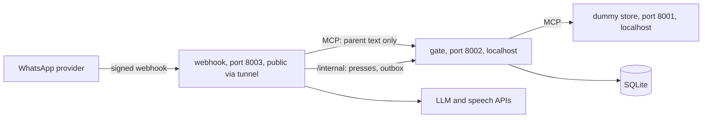

# Ordr TRD (technical requirements)

**Version:** 1.0, 24 Nov 2026. **Product spec:** `Ordr-PRD-v1.4.md` (v1.4.2). The PRD says what and why. This says how and who. If they differ, follow the PRD and flag it.

## 1. Roles

| Person | Share of coding | Owns |
|---|---|---|
| **Niranjan** | 50 to 55% | Dummy store, gate, database, all safety checks, audit log, MCP server, integration |
| **Arya** | 40% | Webhook, WhatsApp and Telegram adapters, LLM loop, item matching, speech |
| **Joel** | About 5% | WhatsApp accounts and phones, product catalogue, manual testing, demo recording |
| **Farzin** | About 5% | PPT, video script and edit, voice notes, family interviews, submission |

Joel and Farzin carry little code but own things the submission fails without. Niranjan reviews Arya's pull requests and Arya reviews Niranjan's. Either can review Joel's and Farzin's.

### Niranjan
| # | Task | Done when |
|---|---|---|
| N1 | Contract fix: add `WAITING_FOR_CART` (section 5) | Agreed with Arya, tests pass |
| N2 | Dummy store: 10 tools and switches | Store tests pass. `checkout` buys the server-side cart |
| N3 | Database, states, atomic moves | Stop and Approve together: one winner |
| N4 | Canonical JSON, hash, HMAC | Same cart in any order gives the same hash |
| N5 | `prepare_order`, search cache, caps, duplicate check | Unknown item ID refused |
| N6 | Confirm, Approve, final checks, checkout, read-back, pay | Happy path and tamper refusal work without WhatsApp |
| N7 | Audit log, outbox, internal API | Arya can run against it |
| N8 | Open in store, `NEEDS_REVIEW`, `verify_log` | If time allows, after N1 to N7 |

### Arya
| # | Task | Done when |
|---|---|---|
| A1 | `Channel` adapter: Meta, then Twilio or Telegram | One button and one voice note received, signature checked |
| A2 | Webhook pipeline (section 4) | Repeats, strangers and the kid's free text never reach the model |
| A3 | Button presses to the gate, outbox to the channel | Confirm and Approve work on real phones |
| A4 | LLM loop with the five MCP tools | Typed "milk and atta" becomes `prepare_order` |
| A5 | Item matching and clarifying question | Unclear item asks, never guesses |
| A6 | Speech-to-text, then text-to-speech | Kannada voice note in, Kannada read-back out |
| A7 | Household defaults | After N5 and A5 |

Until N7 is ready, Arya works against a fake gate that returns fixed responses in the section 6 shapes.

### Joel
| # | Task | Done when |
|---|---|---|
| J1 | Meta app and test number. Add both demo phones. Twilio sandbox as backup. Put tokens in each person's `.env`, never in chat groups or git | Arya has working credentials. **First job of the day** |
| J2 | `catalogue.json`: about 15 products (two milks, two pack sizes, atta), prices in paise, Kannada and English names | Loads in the store tests |
| J3 | Manual test sheet from PRD section 8, run on real phones | Pass or fail against each line |
| J4 | Cloudflare tunnel, webhook URL, phone screen recording | Demo can be started from a written checklist |
| J5 | Record the demo, plus a backup take | Raw clips shared by 8 PM |

### Farzin
| # | Task | Done when |
|---|---|---|
| F1 | PPT on the official template | Draft by 1 PM, checked against PRD section 10 claims |
| F2 | 3 family interviews and voice notes, with consent | Notes shared. Audio stays out of git |
| F3 | `expected.json`: for each voice note, the items expected | Arya can measure match rate |
| F4 | Video script, edit (3 to 5 min), upload | Public or unlisted link that opens in incognito |
| F5 | README polish, repo public, Devnovate submission | Submitted by 10 PM |

## 2. Tech stack

"Checked" means read in docs or run by us. Nothing has been tested on a real WhatsApp number yet.

| Layer | Choice | Why | Fallback | Status |
|---|---|---|---|---|
| Language | Python 3.11+ (CI uses 3.12) | One language for all | None | Scaffold runs on 3.14 and 3.12 |
| MCP | FastMCP 4.x, Streamable HTTP | Server and client in one library | None | Run: MCP plus a private endpoint in one app, caller passed by header |
| Web | FastAPI, uvicorn | Webhook and internal API | None | Run |
| Database | SQLite, WAL mode | No setup, real transactions | None | Built in |
| Validation | Pydantic 2 | Strict inputs | None | Run |
| WhatsApp | Meta Cloud API test number | Real WhatsApp buttons | Twilio sandbox, then Telegram | To verify. 90 min limit |
| LLM | Claude Opus 5.5 (`claude-opus-5-5`), official `anthropic` SDK | Strong tool use and language handling | Set by `LLM_MODEL` | **Needs API credit.** Not covered by Claude Pro |
| Speech-to-text | Sarvam `saaras:v4`, `kn-IN` and `en-IN` | Docs list Kannada, code-mix and OGG/Opus input | Whisper or Google Cloud | Docs checked, quality not tested |
| Text-to-speech | Sarvam `bulbul:v4-flash`, `kn-IN` | Docs list Kannada and Opus output | Text only; ElevenLabs later | Docs checked, quality not tested |
| Audio convert | `imageio-ffmpeg` | WhatsApp voice messages need OGG with Opus | Send as plain audio | To verify |
| Tunnel | Cloudflare quick tunnel | No account needed. No uptime guarantee; URL changes on restart | ngrok | Docs checked |
| Tests, lint, CI | pytest, ruff, GitHub Actions | Already set up | None | Passing |
| UPI | Simulated | No real money | None | By design |

No Docker, Redis, queue, ORM or cloud hosting. Everything runs on one laptop.

### LLM cost and choice
Rough estimate, not measured: one order is about 4 model calls, 12k tokens in and 1.5k out.

| Model | Price per 1M tokens, in / out | Estimate per order |
|---|---|---|
| `claude-opus-5-5` (default) | $4 / $20 | About $0.08 |
| `claude-haiku-5-5` | $0.10 / $0.50 (prompts up to 100k tokens) | About $0.002 |

Start with Opus. Switching to Haiku is a team decision, after both are run on Farzin's test set. Gemini's free tier is not recommended: users report about 20 requests a day on Flash, which is about 5 orders.

Sarvam gives Rs 100 of free credits per verified user, enough for a demo. Simple speech-to-text calls take up to 30 s of audio.

## 3. Processes

| Process | Holds | Never holds |
|---|---|---|
| webhook (Arya) | Channel, LLM and speech keys, `INTERNAL_TOKEN` | Store token, `SERVER_KEY`, database |
| gate (Niranjan) | `SERVER_KEY`, store token, safe-phrase, database, `INTERNAL_TOKEN` | Channel, LLM and speech keys |
| store (Niranjan) | Catalogue, carts | Anything real |

- Only 8003 is public. `/internal` and `/mcp` live on 8002, bound to `127.0.0.1`. **Never tunnel 8002.**
- The webhook calls the gate with headers `x-ordr-internal: <INTERNAL_TOKEN>` and `x-ordr-number: <verified sender>`. Both are set by code. The model never sees or sets them. The gate compares the token in constant time, then maps the number to household and role itself.
- The MCP endpoint accepts only the parent's number.
- The gate mounts MCP and `/internal` in one FastAPI app. FastMCP's lifespan must be passed to FastAPI.

## 4. Message pipeline (webhook)

1. Check the signature on the raw body. Fail: 403. Meta: `X-Hub-Signature-256`, HMAC-SHA256 with the app secret. Twilio: `X-Twilio-Signature`. Telegram: `X-Telegram-Bot-Api-Secret-Token`.
2. Save `message_id`. Seen before: return 200, do nothing. Meta retries for up to 7 days.
3. Return 200 at once. Do the rest in the background, in order per household. If the process dies after step 3, the message is lost and the person sends it again.
4. Unknown number: drop.
5. Button press: `POST /internal/action`. Stop here.
6. Kid's text: "log" returns the log, anything else a fixed reply. Stop here.
7. Parent's voice: speech-to-text. Over 30 s or empty result: ask to send a shorter note.
8. Parent's text goes to the LLM loop.

### LLM loop
- We run the loop ourselves on the Messages API, because the bot is our MCP client and the gate is on localhost.
- Tools come from the gate's `list_tools`. Maximum 8 tool rounds per message, 60 s in total.
- New conversation for each order. Keep the model's `response.content` unchanged in history.
- `max_tokens` 16000, effort `low` first. Thinking is always on for this model, and forced `tool_choice` is rejected.
- Opt in to server-side refusal fallback. If the final answer is still a refusal, or the API fails, send a fixed "please try again".
- **If `prepare_order` succeeded, throw away the model's text.** The gate sends the read-back. Otherwise the text is sent as a question, 300 characters at most.
- Product names are untrusted text. They go into tool results only, never into the system prompt.
- The installed SDK is on major version 2, so check current SDK docs before writing the client.

## 5. Gate

### States
`contracts.py` is the source. **One change needed (N1):** `prepare_order` may have to wait for the kid to tap Replace, and there is no state for that.
- Add `WAITING_FOR_CART`, going to `PREPARED`, `ABORTED` or `EXPIRED`.
- It counts as open. Nothing is written to the kid's cart in this state.

### Database

| Table | Key columns |
|---|---|
| `households` | `id`, `parent_number` unique, `kid_number` unique, `store_account`, `address_id`, `address_text` |
| `mandates` | `id`, `household_id`, `store_account`, `state`, `cart_json`, `cart_hash`, `quote_json`, `total_paise`, `max_total_paise`, `nonce` unique, `approval_sig`, `is_duplicate`, `created_at`, `expires_at`, `order_id`, `paas_id`, `reason`, `reviewed_at` |
| `search_results` | `household_id`, `sku_id`, `spin_id`, `payload_json`, `seen_at` |
| `defaults` | `household_id`, `phrase`, `sku_id`, `spin_id`, `pack`, `qty`, `last_confirmed` |
| `actions_seen` | `message_id` primary key |
| `outbox` | `id`, `to_role`, `household_id`, `kind`, `payload_json`, `sent_at` |
| `audit_log` | `seq`, `ts`, `household_id`, `mandate_id`, `event`, `data_json`, `prev_hash`, `row_hash` |

The webhook keeps its own small `seen_messages` store for step 2.

Rules:
- State change: `UPDATE mandates SET state=:new WHERE id=:id AND state=:old`. Continue only if exactly one row changed. The log row and outbox rows are written in the same transaction.
- A partial unique index allows one open mandate per `store_account`. Open includes `NEEDS_REVIEW` with no `reviewed_at`.
- Reserve the mandate row before touching the store cart.
- Never keep a transaction open during a store call.
- Money is whole paise. Convert once, in the store adapter, using `Decimal`. Times are UTC.

### Approve, in order
1. `PARENT_CONFIRMED` to `APPROVED`, sign with HMAC.
2. Read the live cart from the store.
3. Run the PRD section 6 checks, including that only one order would be created.
4. `APPROVED` to `COMMITTING` (mark used).
5. `checkout` with UPI set explicitly, 15 s timeout. Error or timeout: read `get_orders`, never call again. Not clearly placed: `NEEDS_REVIEW`.
6. Read the order back with `get_orders`. It has no `spinId`, so compare `sku_id`, qty, address and total. Mismatch: `NEEDS_REVIEW`, no payment message.
7. `PLACED_PENDING_PAYMENT`. Only now write the payment message to the outbox.

## 6. Interfaces

### MCP tools (assistant)
Fixed by tests in `test_contracts.py`. Results:

| Tool | Returns |
|---|---|
| `search_products` | `{products: [{sku_id, spin_id, name, brand, pack, price_paise, in_stock, max_qty, household_default}]}` |
| `prepare_order` | `{mandate_id, status: "prepared" or "waiting_for_kid"}` |
| `get_order_status` | `{mandate_id, state}` |
| `abort_order` | `{mandate_id, state}` |
| `get_audit_log` | `{entries: [{ts, event, mandate_id}]}` |

Errors are short codes: `item_not_from_search`, `order_already_open`, `over_cap`, `needs_review`, `not_found`, `store_error`, `not_available`.

### Internal API (webhook to gate)

| Call | Body | Returns |
|---|---|---|
| `POST /internal/action` | `{message_id, action, mandate_id}` | `{ok, code}`. Repeats return the first result's code without acting again |
| `GET /internal/outbox` | none | `[{id, number, kind, text, speak, lang, buttons}]`, unsent rows in id order, at most 50. `buttons` is `[{action, mandate_id, label}]`, 3 at most, labels 20 characters at most |
| `POST /internal/outbox/ack` | `{ids}` | `{ok}` |
| `GET /internal/log` | none | Plain text log for the caller's household, no numbers. Works for the parent or the kid |

Every `/internal` call needs `x-ordr-internal`, or the answer is 403 before anything else is read. `POST /internal/action` and `GET /internal/log` take the person from `x-ordr-number`. A number in the body is refused (422). Bodies are strict: extra fields are refused.

Text in the outbox is final. The webhook sends it as is, and speaks it if `speak` is true (parent messages). A message may be sent twice if the webhook dies before the ack. That is safe, since buttons are single use. The webhook polls every 0.5 s.

**Stale rows are never sent.** A `readback` row needs its mandate in `PREPARED`, `kid_card` in `PARENT_CONFIRMED`, `replace_cart` in `WAITING_FOR_CART`, `payment` in `PLACED_PENDING_PAYMENT`, and none of them may have `stop_requested_at`. Any other row is marked sent and an `outbox_dropped` audit row is written. A row that cannot be rendered is closed the same way (`why: unrenderable`). So after the parent taps Confirm, the read-back is not sent again.

### Message templates
Written in `gate/messages.py`, in Kannada and English, from the outbox payload only. The parent's language is `PARENT_LANG` (`kn` or `en`, default `kn`), the kid's is English. The safe-phrase is added to kid messages when the text is rendered, never stored in the payload.

| Kind | To | Notes |
|---|---|---|
| `readback` | parent | Confirm and Stop. "Order again" if duplicate |
| `waiting_for_kid` | parent | Stop |
| `replace_cart` | kid | Replace, Not now |
| `order_failed` | both | `code`: `not_available`, `over_cap`, `store_error`, `internal`, `not_found`, `not_now` |
| `kid_card` | kid | Approve and pay (or Approve duplicate), Reject |
| `sent_to_kid` | parent | Stop |
| `rejected` | parent | No buttons |
| `expired`, `unpaid` | both | No buttons |
| `stopped` | both | `do_not_pay` for a kid whose order was already placed |
| `blocked` | both | `reason`: `not_approved`, `bad_signature`, `cart_changed`, `over_ceiling`, `out_of_stock`, `not_serviceable`, `over_cap`, `payment_not_allowed`, `store_error`, `internal` |
| `payment` | kid | Pay, Don't pay. Says "simulated" |
| `receipt` | both | Paid total, order ID |
| `needs_review` | both | The kid gets "I have checked it" |

A test fails if a kind, `blocked` reason or `order_failed` code in the code has no template. Long carts lose item lines first and say so. The total, "up to" amount, warning and address stay. Product names are shown as the store gives them, with whitespace collapsed. A Kannada speaker on the team checks the wording. The webhook's own fixed replies (for the kid's free text) are Arya's and are not outbox kinds.

## 7. Configuration
All in `.env`. N7 and A1 add the missing names to `.env.example`.

| Process | Variables |
|---|---|
| gate | `SERVER_KEY`, `INTERNAL_TOKEN`, `DB_PATH`, `POLICY_PATH`, `STORE_MCP_URL`, `PARENT_NUMBER`, `KID_NUMBER`, `SAFE_PHRASE`, `PARENT_LANG` |
| webhook | `INTERNAL_TOKEN`, `GATE_URL`, `CHANNEL`, `META_TOKEN`, `META_APP_SECRET`, `META_PHONE_ID`, `META_VERIFY_TOKEN`, or the Twilio or Telegram equivalents, `ANTHROPIC_API_KEY`, `LLM_MODEL`, `SARVAM_API_KEY` |

- A process refuses to start if a key it needs is empty. No default secrets. The gate also refuses numbers that are not digits only or are the same, and a changed number against an existing `ordr.db` (delete it to start again).
- `SERVER_KEY` and `INTERNAL_TOKEN`: at least 32 random bytes.
- Meta's temporary token lasts under 24 hours. Make a system user token.

## 8. Requirements

| Area | Target |
|---|---|
| Speed (goal, not measured) | Text to read-back under 15 s; Approve to payment message under 10 s |
| Safety | Every test in PRD section 8. Failure of any check: zero `checkout` calls |
| Logging | No tokens, safe-phrase, phone numbers or message text in logs. Numbers shown as last 2 digits |
| Privacy | Audio deleted after transcription. Nothing personal in git |
| Demo panel | MCP calls written to a JSON lines file and shown in a terminal, for the video |
| Platform | Runs on Windows with the steps in `CONTRIBUTING.md` |

## 9. Testing

| Level | Owner | What |
|---|---|---|
| Unit | Niranjan, Arya | Hash, states, parsing, signatures |
| Gate | Niranjan | Full flow against the dummy store, no WhatsApp |
| Pipeline | Arya | Fake channel and fake gate. Kid's text and presses never reach the model |
| Match rate | Arya, Farzin | Real voice notes against `expected.json`. Report the number, however bad |
| Phones | Joel | Test sheet on two real phones |

Tests never call paid APIs.

## 10. Today

| Time | Niranjan | Arya | Joel | Farzin |
|---|---|---|---|---|
| 9 to 10 | N1, agree section 6 | Agree section 6, start A1 | J1 | F2 messages, F1 |
| 10 to 1 | N2 to N5 | A1 to A3 on the fake gate | J2, J4 | F1 draft |
| 1 to 4 | N6, N7, join up | A4, join up | J3 on the typed flow | F2, F3, F4 script |
| 4 to 6 | Fix, N8 if time | A5, A6 | J3 again | Slides with real screenshots |
| **6** | **Feature freeze** | | | |
| 6 to 8 | Fix bugs only | Fix bugs only | J5 | F4 voiceover |
| 8 to 10 | Review, README check | Review | Help edit | F4, F5. **Submit by 10** |

**Checkpoints**
- **11 AM:** WhatsApp not working after 90 min: Telegram, and say so on screen.
- **4 PM:** typed order, Confirm, Approve, placed, tamper refused. If not working, drop voice and N8. Everyone helps here.
- **6 PM:** anything not working is shown as "next", never as done.

**Cut order:** Open in store, duplicate warning, household defaults, voice read-back, Kannada voice in.

## 11. Open

| Question | Owner |
|---|---|
| Claude API key: Niranjan is getting one from a friend. Needed before A4, with a spending limit. In `.env` only, deleted after 2 Dec | Niranjan |
| Meta test number: do buttons and voice notes work for us? | Joel, Arya |
| Does Sarvam's Opus output play as a WhatsApp voice message, or does it need converting? | Arya |
| Is Sarvam good enough on our families' voice notes? | Arya, Farzin |
| Team name | All |
| Real Swiggy `get_orders` may not return Instamart item IDs (the docs show `itemId` as optional). If it does not, step 6 cannot compare `sku_id`. Check against the docs and decide the fallback | Niranjan |
